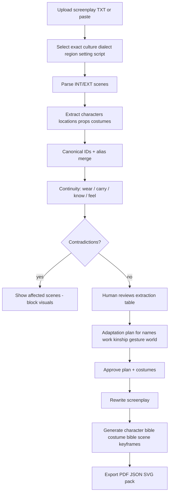
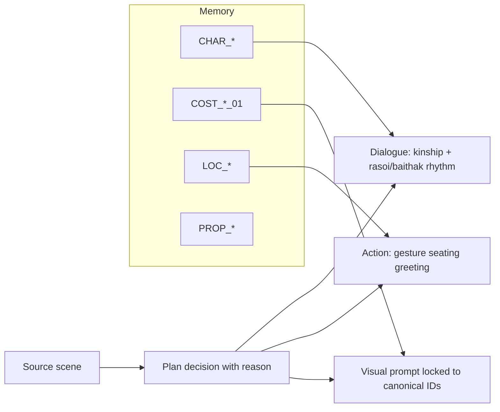

# Cultural Screenplay and Visual Adaptation Studio

Working MVP for the OTT dialect-platform hiring challenge: take a short screenplay, recreate it in an **exact** Indian dialect (default **Majhi Punjabi**, rural Majha), keep continuity canonical, then export a production pack with character, costume, and scene visuals.

## Why this assignment

Three briefs were attached. This one was implemented because it is the strongest **portfolio + job** combination:

| Brief | Job signal | Attractiveness | Completeness here |
| --- | --- | --- | --- |
| Learn Nadi-9 | Strongest pure LLM-uncertainty work | CLI, needs a secret evidence pack we were not given | Not chosen |
| Trailer director | Strong multimodal + rights/safety | Edit lists, optional video, needs episode media we were not given | Not chosen |
| **Cultural adaptation studio** | Product AI + extraction + continuity + human gates + multimodal pack | **Web MVP you can demo** | **Implemented end to end** |

It maps cleanly to roles in **applied LLM / AI engineering, OTT localisation, and production tooling**: structured extraction, canonical memory, approval gates before expensive generation, culture isolation, and traceable adaptation (not word-for-word translation).

Acceptance culture for the 48-hour test: **Majhi**, rural Amritsar / Tarn Taran belt, Roman Punjabi (optional Gurmukhi-marked track). A second pack (**Malwai**) exists only to prove cultures do not leak.

## Setup

```bash
cd /path/to/stage
python3 -m venv .venv
source .venv/bin/activate
pip install -r requirements.txt
cp .env.example .env
```

System: Python 3.11+, no API key required (`LLM_PROVIDER=mock`). Visuals are a deterministic cinematic SVG production renderer (character bible, costume plates, scene keyframes) plus copy-paste prompts for a hosted image model.

Live explanation: follow [DEMONSTRATION.md](DEMONSTRATION.md) beat by beat.

### Web app

```bash
uvicorn app.main:app --reload --port 8000
```

Open [http://127.0.0.1:8000](http://127.0.0.1:8000). Click **Load sample screenplay**, extract, approve, rewrite, generate, export.

### CLI (reproduces `sample_output/`)

```bash
python -m app.cli \
  --screenplay app/data/sample_screenplay.txt \
  --culture majhi --setting rural --script roman \
  --auto-approve --out sample_output
```

### Tests

```bash
pytest -q
```

## Product flow



Visual generation is **refused** until extraction, cultural plan, and costumes are approved. One failed SVG can be retried without rebuilding the project (`POST /api/projects/{id}/assets/{asset_id}/retry`).

## How adaptation works



Majhi is not a costume overlay. The shop is **Mama Jagtar's kiryana**; Mother is **Bebe**; public refusal is avoided on the mandi road; the letter must stay in Jaswant's pocket until the baithak table. Malwai uses **Maa / Harbans / Balwinder** in a separate project so prompts never mix.

## Sample output (already generated)

| Path | What it is |
| --- | --- |
| `sample_output/adapted_screenplay.pdf` | Adapted Majhi screenplay |
| `sample_output/scene_breakdown.json` | Structured scenes |
| `sample_output/continuity_report.pdf` | Wear / carry / knowledge / contradictions |
| `sample_output/character_bible/` | Full-body SVG + canonical IDs |
| `sample_output/costume_bible/` | One costume variant per character |
| `sample_output/scene_keyframes/` | One keyframe per scene |
| `sample_output/visual_assets.json` | Model, prompt, seed for each asset |

## Architecture notes

See [ARCHITECTURE.md](ARCHITECTURE.md) for planning, memory, verification, failure recovery, and trust boundaries.

Known gaps: [KNOWN_LIMITATIONS.md](KNOWN_LIMITATIONS.md). How this coding assistant was used: [AI_USAGE.md](AI_USAGE.md).
